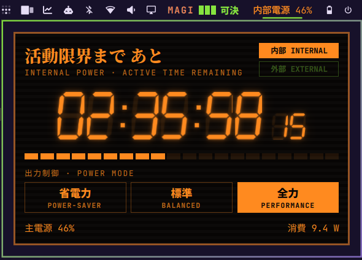

# EVANGELION Internal Power Timer

Your battery as the Evangelion internal power countdown — **活動限界まで あと**,
the seven-segment timer that starts when the umbilical cable is pulled.



## What it does

**Bar widget**

- On battery: `内部電源 46%` in amber, red and blinking under the critical
  threshold (10 minutes by default).
- On AC: `外部電源 NN%` in EVA-01 lime.
- Hover: the countdown (`活動限界まで 02:35:58`) and the current power mode.
- Left click: opens the internal power screen.
- Right click: cycles the power mode.

**Popup**

- Seven-segment `HH:MM:SS.cc` countdown, smoothed between UPower re-estimates.
- 内部 INTERNAL / 外部 EXTERNAL lamps, a segmented charge gauge, power draw in W,
  and time to full when charging.
- 出力制御 · POWER MODE: 省電力 (power-saver) / 標準 (balanced) / 全力 (performance),
  applied with Omarchy's `omarchy-powerprofiles-set` for the current source (AC
  or battery). Arrow keys + Enter work too.

**Service**

When you plug or unplug the charger, a click-through alert flashes for a few
seconds on every screen: **内部電源に切り替わりました** (switched to internal
power) or **外部電源 接続** (external power connected).

Battery data comes from UPower through Quickshell; no extra packages.

## Install

```sh
omarchy plugin add https://github.com/remulef/omarchy-internal-power-evangelion.git --enable
```

If the widget doesn't show in the bar, place it with
`omarchy bar move evangelion.internal-power --section right`.

Japanese text uses **Noto Serif CJK JP** / **Noto Sans CJK JP** (shipped with
Omarchy's `noto-fonts-cjk`). Power modes need `power-profiles-daemon` (Omarchy's
default).

## Settings

| Key | Default | |
|---|---|---|
| `hideOnExternal` | `false` | Hide the widget while plugged in |
| `criticalMinutes` | `10` | Turn red and blink below this many minutes |

## Remove

```sh
omarchy plugin remove evangelion.internal-power
```

Fan project, not affiliated with Khara or Gainax. Evangelion belongs to its
respective owners.
